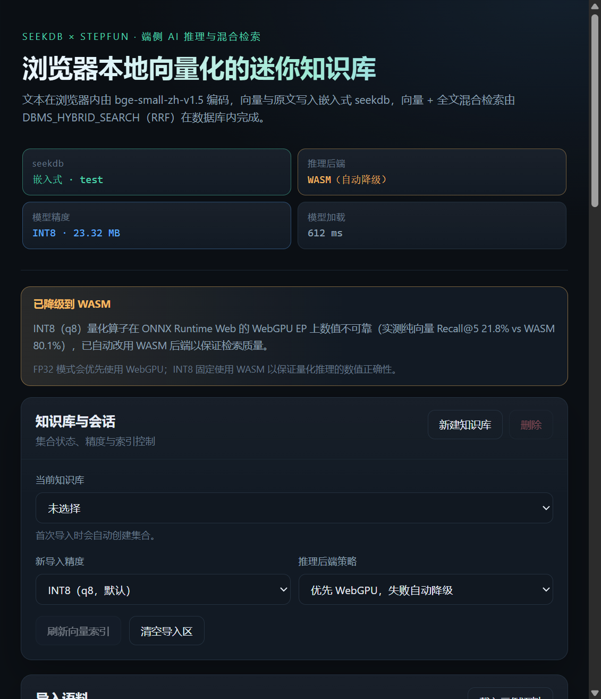
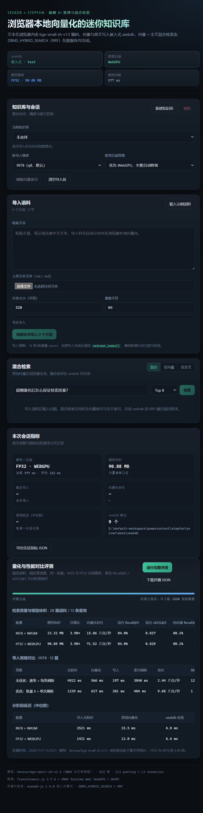

# 复现步骤与测试日志

## 0. 环境

| 项 | 值 |
| --- | --- |
| OS | Windows 11 |
| Node.js | v24.19.0（npm 11.17.0） |
| CPU / GPU | AMD Ryzen 7 6800H / NVIDIA GeForce RTX 3050 Ti Laptop GPU |
| 浏览器 | Chromium（WebGPU 可用），Edge 156.0.4314.58 |
| seekdb-js | 1.4.0（嵌入式模式，数据库 `test`） |
| 模型 | `Xenova/bge-small-zh-v1.5`，q8 + fp32 ONNX |

## 1. 安装与启动

```bash
cd stepfun
npm install
npm run fetch:model
npm run dev
```

打开 `http://localhost:5173`。生产模式：

```bash
npm run build
npm start        # http://localhost:8787
```

## 2. 后端全链路冒烟（`scripts/smoke-test.mjs`）

执行：

```bash
node scripts/smoke-test.mjs
```

日志见 [`scripts/smoke-test.log`](../scripts/smoke-test.log)，关键结果：

```
created: kb_mw0bves8_q8 count= 0
add+refresh: {"written":3,"writeMs":52.1,"refreshMs":5144.8,"count":3}
hybrid: 25.5ms ["smoke-1","smoke-2","smoke-3"]
hybrid terms: ["seekdb","混合检索"]
vector: 4.3ms ["smoke-1","smoke-2","smoke-3"]
incremental add+refresh: {"written":1,"writeMs":10.6,"refreshMs":403.1,"count":4}
after refresh: ["smoke-4","smoke-3","smoke-1","smoke-2"]
fulltext mode: ["smoke-4"]
deleted kb_mw0bves8_q8 total 8786 ms
```

验证内容：创建集合 → 写入 3 条 → 冷启动 `refresh_index`（5.1 s）→ 混合检索 → 纯向量检索 →
增量写入 1 条并刷新（403 ms）→ 新文档可检索 → 全文检索 → 删除集合。

## 3. 浏览器端验证

### 3.1 模型加载与后端提示

1. 打开 `http://localhost:5173`，等待模型加载完成（本地 `/models/`，q8 约 23.32 MiB）。
2. 默认策略下，INT8 自动使用 WASM，顶部出现黄色横幅：

> 已降级到 WASM — INT8（q8）量化算子在 ONNX Runtime Web 的 WebGPU EP 上数值不可靠
> （实测纯向量 Recall@5 21.8% vs WASM 80.1%），已自动改用 WASM 后端以保证检索质量。



3. 将「新导入精度」切到 FP32，等待重新加载，状态栏显示 `FP32 · WEBGPU`，无降级横幅。

### 3.2 导入与增量刷新

1. 点击「载入示例语料」（内置 28 篇，分块后 56 个片段）。
2. 点击「向量化并写入 56 个片段」，观察进度：本地向量化 → 批量写入 seekdb → 刷新向量索引。
3. 观察到（WebGPU q8 实验路径）：向量化 3857 ms、写入 664 ms、刷新 443 ms、端到端 5350 ms；
   导入完成后 56 条全部可检索。
4. 页面提示「已写入 56 个片段，索引刷新完成，新内容可检索」。

### 3.3 混合检索

默认查询「端侧量化后怎么保证检索质量？」、模式「混合」、Top 8：返回 8 条命中，
查询向量化 132 ms、seekdb 检索 32.6 ms、端到端 165 ms；全文词项展示为
`端侧量 / 化后怎 / 么保证 / 检索质`。切换「仅全文」「仅向量」均返回结果，证明三种模式都可用。

## 4. 量化与性能评测（页面「运行完整评测」）

固定 28 篇语料、13 条带相关性标注的查询；INT8 与 FP32 各自重建集合。评测时间
`2026-11-03 15:25:21`。

| 配置 | 模型体积 | 压缩比 | 向量化吞吐 | 混合 R@5 | 混合 nDCG@5 | 纯向量 R@5 | 纯向量 nDCG@5 |
| --- | --- | --- | --- | --- | --- | --- | --- |
| INT8 (q8) + WASM | 23.32 MiB | 3.90× | 15.86 片段/秒 | 84.0% | 0.827 | 80.1% | 0.813 |
| FP32 + WebGPU | 90.88 MiB | — | 71.52 片段/秒 | 84.0% | 0.829 | 80.1% | 0.815 |


导入策略对比（INT8，12 篇）：

| 策略 | 总耗时 | 向量化 | 写入 | 索引刷新 | 吞吐 | 刷新次数 |
| --- | --- | --- | --- | --- | --- | --- |
| 未优化：逐条 + 每条刷新 | 4922 ms | 566 ms | 197 ms | 3840 ms | 2.44 片段/秒 | 12 |
| 优化：批量 8 + 单次刷新 | 1239 ms | 617 ms | 201 ms | 404 ms | 9.68 片段/秒 | 1 |

分阶段延迟（中位数）：

| 配置 | 导入总耗时（28 篇） | 查询向量化 | seekdb 检索 |
| --- | --- | --- | --- |
| INT8 + WASM | 2521 ms | 15.5 ms | 6.8 ms |
| FP32 + WebGPU | 1431 ms | 12.0 ms | 6.6 ms |



## 5. WebGPU INT8 异常与路由证据

同机同语料下，仅改变推理后端：

| 后端 | 纯向量 Recall@5 | 混合 Recall@5 | 向量化吞吐 |
| --- | --- | --- | --- |
| q8 + WebGPU | 21.8% | 69.2% | 17.42 片段/秒 |
| q8 + WASM | 80.1% | 84.0% | 21.19 片段/秒 |

结论：ORT WebGPU EP 对 q8 量化算子的执行结果不可靠且更慢。最终实现将 INT8 固定路由到
WASM 并在 UI 明示原因，FP32 使用 WebGPU。强制 WASM 选项保留，可随时复验降级路径。

## 6. 生产构建验证

```
dist/assets/worker-*.js  877.74 kB
dist/assets/index-*.js   260.84 kB
dist/index.html            0.55 kB
Built in 921ms
```

以 `npm start` 启动后实测：

| 路径 | 状态 | Content-Type | 大小 |
| --- | --- | --- | --- |
| `/` | 200 | text/html | 559 B |
| `/ort/ort-wasm-simd-threaded.jsep.mjs` | 200 | text/javascript | 44,484 B |
| `/ort/ort-wasm-simd-threaded.jsep.wasm` | 200 | application/wasm | 21,596,019 B |
| `/models/Xenova/bge-small-zh-v1.5/config.json` | 200 | application/json | 716 B |
| `/api/kbs` | 200 | application/json | 10 B |

## 7. 已知问题与规避

1. **嵌入式 seekdb 并发崩溃**：Windows 下并发访问原生引擎会触发 `0xC0000005`。服务端用单一
   Promise 队列串行化全部 `/api` 请求，连续 6 个并发请求实测全部 200。
2. **Vite 动态导入 public 目录**：ORT loader 的 `.mjs` 改为 fetch + Blob URL，`.wasm` 用
   同源绝对 URL，开发与生产一致。
3. **模型体积统计**：浏览器资源计时受缓存影响（暖缓存会少算 tokenizer），评测统一使用
   `web/src/data/corpus.ts` 中的真实文件字节清单（q8 24,451,175 B / fp32 95,292,210 B）。
